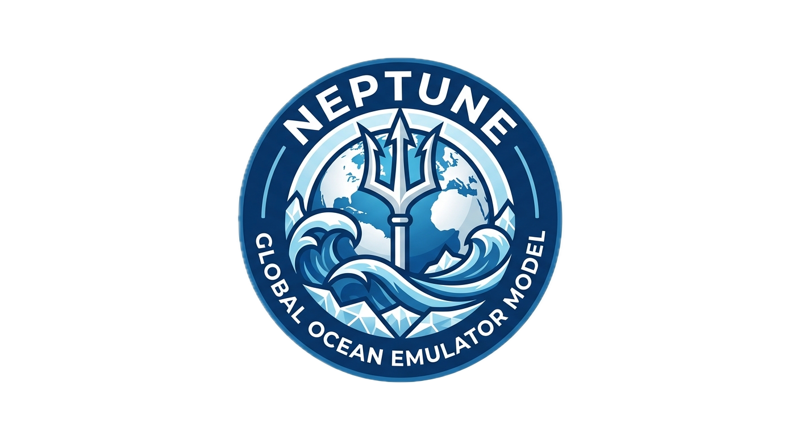
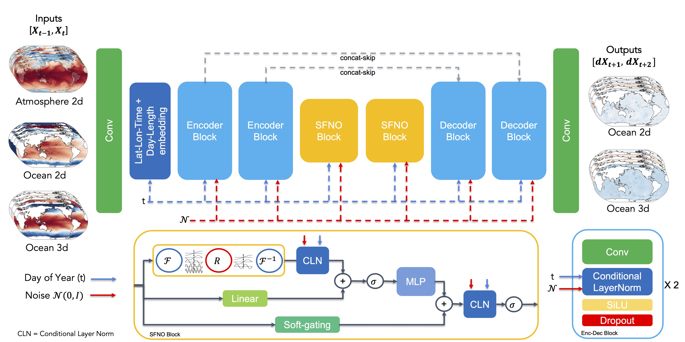
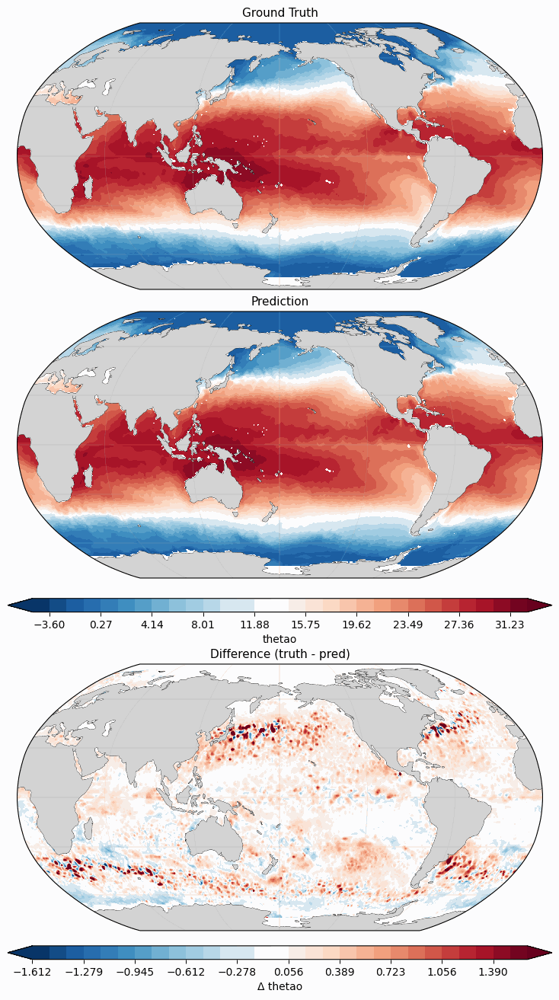
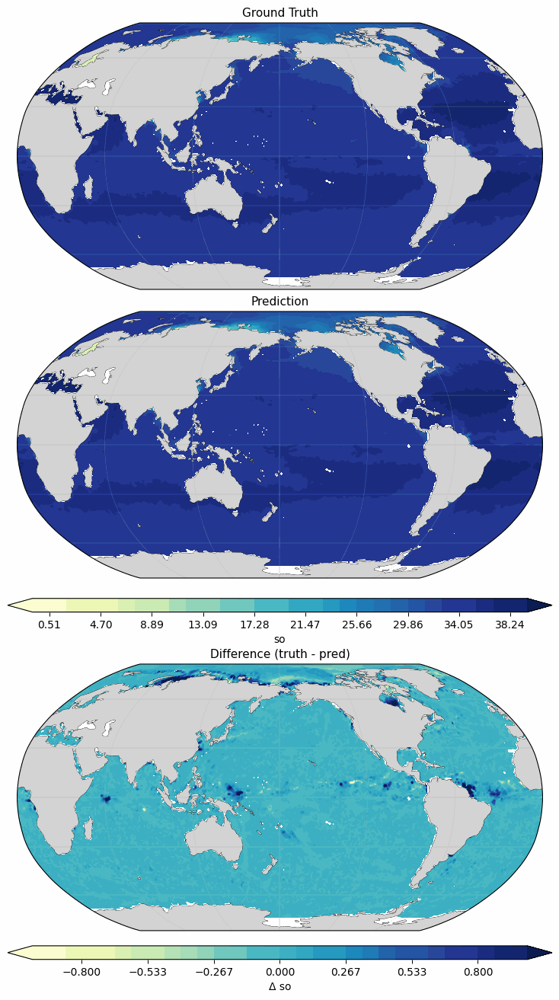
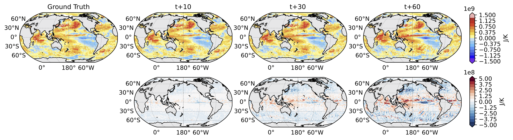
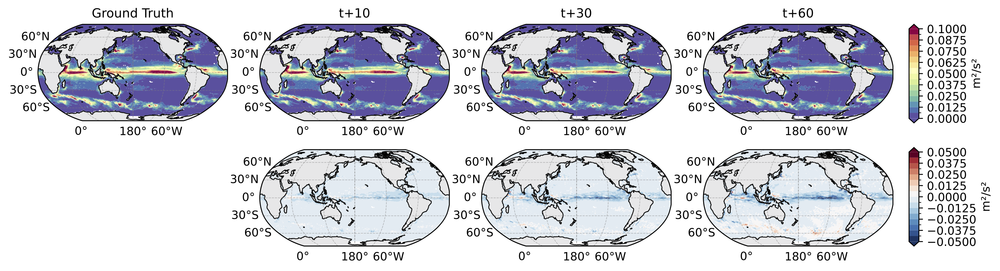
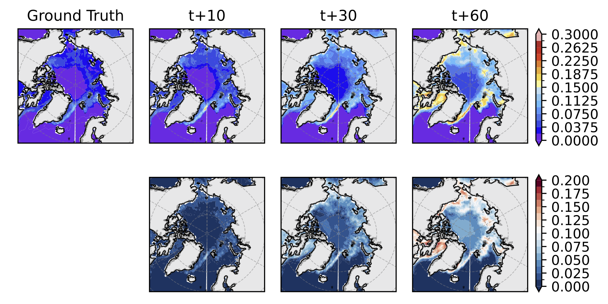
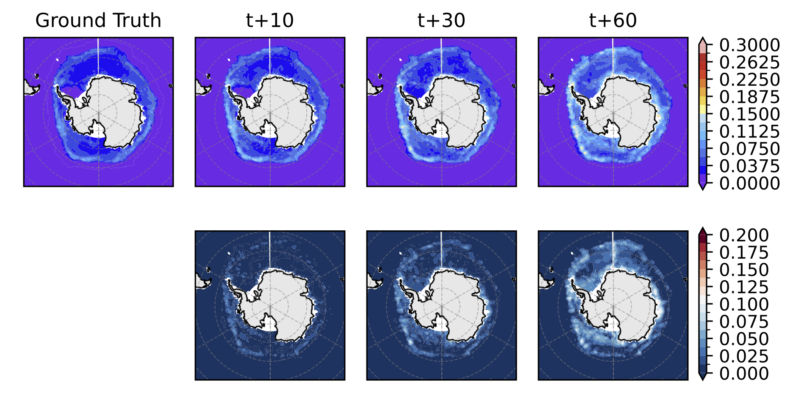

<p align="center">
    
</p>

# Neptune

Neptune is an end-to-end data-driven framework for the global ocean and sea-ice components, designed for subseasonal-to-seasonal (S2S) prediction up to 60 days. The model combines convolutional neural networks (CNNs) and spherical Fourier neural operators (SFNOs) to learn local patterns and global multiscale interactions while conditioning on daily atmospheric forcing.

<p align="center">
    
</p>


The codebase includes:

- a PyTorch training pipeline for ocean state emulation;
- custom model layers and architectures;
- dataset preparation and normalization utilities;
- processing scripts for atmospheric and ocean data;
- inference utilities to generate forecasts from trained models;
- validation and visualization tools for benchmark and reanalysis comparisons.

## Temperature and Salinity Gifs

<table>
  <tr>
    <td width="50%">
      
    </td>
    <td width="50%">
      
    </td>
  </tr>
</table>

## Repository structure

- `src/`: training and inference entry points, plus training configuration files
  - `src/training.py`: main training script
  - `src/inference.py`: ensemble forecast generation from a trained model
  - `src/training.sh`: example distributed training launcher
  - `src/finetuning.sh`: example fine-tuning launcher
  - `src/config/`: TOML experiment configuration files
- `library/atmocean/`: reusable project code
  - model definitions
  - datasets and scaling tools
  - metrics, losses, callbacks, visualization utilities
  - forecast utilities
- `src/gathering/`: scripts for downloading raw atmospheric and ocean datasets
  - `weatherbench_daily.py`: downloads ERA5 data from WeatherBench2
  - `cmems_daily_wget.py`: downloads CMEMS ocean data
- `src/processing/`: conversion and preprocessing scripts
  - `netcdf_to_npy.py`: converts NetCDF files into `.npy` tensors
  - `merge_and_interp_all_tensors_parallel.py`: merges 2D/3D atmospheric and ocean arrays and interpolates them to target resolution
  - `welford_scaler.ipynb`: computes Welford mean/std normalization statistics (`library/atmocean/stats` contains already computed statistics)
- `data/`: data directories useful for model training, evaluation and inference
  - `data/datasets/`: contains the datasets used for training the DL model
  - `data/masks/`: contains sealand masks at different resolutions
  - `data/models/` - contains the Neptune checkpoints resulting from our experiments
- `validation/`: notebooks for evaluations that can be used to retrieve paper's figures.
  - `ocean_indices`: ENSO and associated Z20 metrics, IOD.
  - `physical_coherency`: OHC, EKE and IBS.
  - `statistical_evaluation`: RMSE, ACC and CRPS.
- `experiments/`: training outputs created at runtime

## Main technologies and dependencies

The project depends on the following core libraries:

- Python 3.10+
- PyTorch
- Lightning
- MLflow
- NumPy
- pandas
- xarray
- SciPy
- matplotlib
- cartopy
- dask
- einops
- toml
- munch
- tqdm
- requests
- pyperlin
- timm
- torch-harmonics
- torchcfm

The repository is intended to leverage GPU facilities for both training and inference. However, small debugging experiments on subset of data can be run locally.

## Expected data layout

The project expects the following folder structure:

```text
data/
  datasets/
    all_1_deg/
    all_025_deg/
    atmosphere/
      raw_data/
      processed/
        2D/
        3D/
    ocean/
      raw_data/
      processed/
        2D/
        3D/
  masks/
    sealand_1_deg/
    sealand_025_deg/
  models/
    neptune-1/
    neptune-025/
```

The training code uses global atmospheric forcing and ocean state variables with daily time resolution and a fixed set of forcing variables defined in `src/config/*.toml`. The expected masks are usually stored as `.npy` files such as:

- `sealand_mask_2d.npy`
- `sealand_mask_3d.npy`

## Configuration files

The project uses TOML files under `src/config/`:

- `src/config/template.toml`: base template and parameter structure
- `src/config/neptune-1.toml`: default large model configuration
- `src/config/neptune-025.toml`: higher-resolution configuration

Each file defines:

- run name and experiment class;
- dataset and experiment paths;
- model hyperparameters;
- training years and validation years;
- optimizer and scheduler settings;
- MLflow configuration;
- optional Discord/Slack webhook settings.

Before training, review and adjust the paths so they match your local filesystem.

## Environment setup

### Hardware

- NVIDIA GPU with CUDA support is strongly recommended.
- For a realistic training run, use a recent NVIDIA GPU with enough VRAM.
- The repo is designed around distributed training, but a single-GPU setup is possible with minor adjustments.

### Operating system

- Linux is the intended environment.
- macOS is not the target runtime for the default training workflow because CUDA and distributed training are assumed.
- Windows is not the recommended platform unless you are deliberately adapting the environment.

### Python

Use Python 3.10 or newer.

### PyTorch

Install a CUDA-enabled PyTorch build compatible with your GPU and driver. For example:

```bash
pip install torch==2.7.1 torchvision==0.22.1 torchaudio==2.7.1 --index-url https://download.pytorch.org/whl/cu118
```

The exact CUDA version and PyTorch build must be selected according to your hardware and driver.

### Python dependencies

Install the project dependencies using the `requirements.txt` file located at `env/requirements.txt`. Alternatively, you can follow the step-by-step environment setup instructions at `env/env_building_steps.txt.`

## Raw data download pipeline

The repository includes dedicated scripts to fetch the atmosphere and ocean raw data before preprocessing.

### 1) Download atmospheric data (ERA5)

The script `src/gathering/weatherbench_daily.py` downloads archived ERA5 daily data from WeatherBench2.

The script expects a project root path and uses the WeatherBench2 public Zarr endpoint:

```python
WEATHERBENCH2_ERA5_DAILY_025_ZARR = 'gs://weatherbench2/datasets/era5_daily/1959-2023_01_10-full_37-1h-0p25deg-chunk-1-s2s.zarr/'
```

It selects the following variables:

- `2m_temperature`
- `surface_pressure`
- `10m_u_component_of_wind`
- `10m_v_component_of_wind`
- `2m_dewpoint_temperature`
- `sea_surface_temperature`
- `sea_ice_cover`
- `mean_sea_level_pressure`
- `total_column_water`
- `total_precipitation_24hr`
- pressure-level variables such as geopotential, temperature, humidity, and winds at 300, 500, 600, 700, 850, 925, 1000 hPa.

**Note**: since downloading the whole dataset is costly, to reduce the storage requirements the user may select **only** the forcing atmospheric variables that we used during training: `2m_temperature`, `2m_dewpoint_temperature`, `10m_u_component_of_wind`, `10m_v_component_of_wind`, `mean_sea_level_pressure`

The output is stored under:

```text
data/datasets/atmosphere/raw_data/
```

This script is meant to be launched with MPI, because it is built to partition the dates across ranks.

Example usage:

```bash
mpirun -np 8 python -u src/gathering/weatherbench_daily.py
```

The script evaluates the years defined in the project macros and writes daily NetCDF files with names like:

```text
{year}-{month}-{day}.nc
```

### 2) Download ocean data (CMEMS)

The script `src/gathering/cmems_daily_wget.py` downloads daily CMEMS ocean data for a given year.

It uses the public CMEMS base URL:

```python
base_url = "https://s3.waw3-1.cloudferro.com/mdl-native-14/native/GLOBAL_MULTIYEAR_PHY_ENS_001_031/cmems_mod_glo_phy-all_my_0.25deg_P1D-m_202311/"
```

The script is parallelized with MPI, and each rank processes one month. Output is organized as:

```text
data/datasets/ocean/raw_data/
  2023/
    01/
      20230101.nc
      20230102.nc
      ...
```

Usage:

```bash
mpirun -np 12 python -u src/gathering/cmems_daily_wget.py --year 2023
```

This script is designed to download one year at a time and stores files in the raw data folder before any transformation.

**Note**: downloaded ocean data includes all the three reanalyses belonging to the ensemble product (i.e., ORAS5, CGLORS and GLORYS). To reduce the storage requirements, the used may select **only** the ocean data belonging to ORAS5 only (ORAS5 variables can be recognized by the `_oras` suffix in the NetCDF files).

### 3) Download or generate sea-land masks

The repository expects land-sea masks to be pre-generated and saved under:

```text
data/masks/
```

Typical files include:

```text
data/masks/sealand_1_deg/
  sealand_mask_2d.npy
  sealand_mask_3d.npy

data/masks/sealand_025_deg/
  sealand_mask_2d.npy
  sealand_mask_3d.npy
```

If the masks do not exist, they must be created or downloaded externally before training/inference. Creation of a mask can be easily done by leveraging the NaN values in the NetCDF ocean data.

## Data processing workflow

After raw NetCDF downloads are available, the project creates `.npy` tensors that match the model input format.

### 1) Convert NetCDF files to `.npy`

The script `src/processing/netcdf_to_npy.py` converts daily raw atmospheric or ocean NetCDF files into processed arrays. It is domain-aware and creates separate outputs for:

- 2D fields
- 3D fields

The output folders are:

```text
data/datasets/atmosphere/processed/2D/
data/datasets/atmosphere/processed/3D/
data/datasets/ocean/processed/2D/
data/datasets/ocean/processed/3D/
```

The script performs tasks such as:

- selecting the relevant vertical levels (`levels` or `depths` from `ALL_DRIVERS`);
- reordering longitude from `[-180, 180]` to `[0, 360]` for ocean data;
- ensuring latitude padding is applied where needed;
- writing one `.npy` file per daily sample.

Usage:

```bash
mpirun -np 8 python -u src/processing/netcdf_to_npy.py --domain atmosphere
mpirun -np 8 python -u src/processing/netcdf_to_npy.py --domain ocean
```

### 2) Merge atmosphere and ocean tensors into a single dataset

The script `src/processing/merge_and_interp_all_tensors_parallel.py` merges the processed 2D and 3D arrays from atmosphere and ocean into a single tensor per daily sample and resamples it if needed.

Key features:

- reads `data/datasets/atmosphere/processed/...` and `data/datasets/ocean/processed/...`;
- concatenates atmospheric and ocean tensors along the channel dimension;
- allows interpolation to a target shape such as `(181, 360)` for 1° or `(361, 720)` for 0.5°;
- writes the final combined arrays to `data/datasets/all_{resolution}_deg/`.

Usage:

```bash
mpirun -np 8 python -u src/processing/merge_and_interp_all_tensors_parallel.py \
  --shape "(181, 360)" \
  --dst "1" \
  --mode "bilinear"
```

This is the preprocessing step that creates the final training-ready dataset in the format used by `NeptuneDataset`.

### 3) Compute data normalization statistics

Normalization is critical for stable training. The notebook `src/processing/welford_scaler.ipynb` implements Welford’s online algorithm for mean and variance estimation.

This is the canonical method used in the repo for computing normalization statistics from the processed dataset. The notebook:

- scans the `.npy` files in `data/datasets/all_1_deg-*`;
- loads them with NumPy;
- accumulates a running mean and standard deviation using Welford’s method;
- reduces over the spatial dimensions and returns per-variable statistics;
- is used to derive the statistics later used by the dataset scaling logic.

The notebook imports macros such as:

```python
from atmocean.macros import ALL_DATA_VARS, MEAN_DATA_VARS, STD_DATA_VARS
```

and computes values like:

```python
welford = Welford(filenames)
std = np.sqrt(welford.S / (welford.k - 1))
```

The final statistics are then used by the dataset loader to standardize fields before feeding them to the model.

**Note**: we already provide computed statistics under `library/atmocean/stats`. However, if new stats are being computed, the user should use this notebook and then manually replace the old statistics with the new ones.

## Training pipeline

The main training script is `src/training.py`.

### Training entry point

```bash
python src/training.py \
  --config src/config/neptune-1.toml \
  --num_nodes 1 \
  --devices 1 \
  --ocean oras5 \
  --atmos era5
```

Required command-line arguments:

- `--config`: TOML configuration file
- `--num_nodes`: number of cluster nodes
- `--devices`: number of devices per node
- `--ocean`: ocean dataset mode (`oras5`)
- `--atmos`: atmospheric dataset mode (`era5`)

### Example MPI launcher

The repository includes a distributed example in `src/training.sh`:

```bash
#!/bin/sh
mpirun -np NUM_PROCS python -u src/training.py \
    --config src/config/neptune-1.toml \
    --num_nodes NUM_NODES \
    --devices NUM_DEVICES_PER_NODE \
    --ocean oras5 \
    --atmos era5
```

Similarly, `src/finetuning.sh` launches a fine-tuning run using a second configuration file.

### What the training script does

`src/training.py` performs the following operations:

- loads the TOML config;
- sets environment variables for `ocean` and `atmos`;
- creates the experiment directory under `experiments/`;
- initializes MLflow logging;
- creates a run directory containing
  - checkpoints,
  - logs,
  - copied config,
  - a snapshot of the `library/` code;
- instantiates the model and optimizer;
- loads the dataset with `NeptuneDataset`;
- starts the Lightning `Trainer`; 
- logs training metrics and artifacts to MLflow;
- writes validation metrics to a CSV benchmark file such as `benchmark.csv`.

### Training outputs

Each experiment is stored under:

```text
experiments/
  <run_name>/
    benchmark.csv
    configuration-pretrain.toml
    library/
    checkpoints/
    logs/
```

During training, the code also logs hyperparameters and artifacts to MLflow under the configured experiment name.

## Inference workflow

The inference pipeline is implemented in `src/inference.py`.

### Inference entry point

```bash
python src/inference.py \
  --model neptune-1 \
  --year 2023 \
  --ensemble 8 \
  --ocean oras5 \
  --atmos era5 \
  --res 1
```

Arguments:

- `--model`: name of the config file without extension, e.g. `neptune-1`
- `--year`: target year for the forecast
- `--ensemble`: ensemble size
- `--ocean`: ocean dataset type
- `--atmos`: atmospheric forcing set
- `--res`: target resolution (`1`, `05`, `025`)

### Inference logic

The script:

- loads a trained model from the selected configuration;
- creates a forecast dataset using `NeptuneForecastDataset`;
- initializes a forecast output store as a Zarr archive;
- iterates date by date over the target year;
- calls the model recursively for the forecast horizon;
- appends predicted fields to the archive;
- stores them under a path such as:

```text
data/forecasts/
  neptune-1-from_2023-01-01_to_2023-12-31-ENS-08.zarr
```

The generated archive is then used for downstream validation, visualization, and analysis.

## Validation and result evaluation

Evaluation is a central part of this repo. The codebase includes several utilities to compare predictions to observations and reanalysis fields.

### 1) Benchmarking during training

The training pipeline uses callbacks to compute validation metrics and write them to `benchmark.csv`.

The file is handled by `library/atmocean/callbacks.py`, where metrics are aggregated per epoch and optionally pushed to Discord or Slack via webhook if configured.

The training results are intended to be monitored through:

- MLflow experiments;
- local CSV checkpoints;
- logs under `experiments/<run_name>/logs/`.

### 2) Metrics and visualization utilities

The library contains metric and plotting helpers in:

- `library/atmocean/metrics.py`
- `library/atmocean/visualize.py`

These utilities are designed to generate scorecards and summary plots for metrics such as:

- RMSE;
- normalized RMSE differences;
- lead-time by lead-time diagnostic plots;
- comparison against reanalysis or reference outputs.

The repository includes notebooks under `validation/` for reproduction and qualitative analysis:

```text
validation/
  ocean_indices/
  physical_coherency/
  statistical_evaluation/
```

This is where the project compares forecast results to reference observations or reanalysis data and checks physical consistency.

### 3) Forecast comparison workflow

The general evaluation workflow is:

1. train or load a model and generate forecast outputs;
2. create or open the forecast Zarr dataset;
3. align timestamps with observation or reanalysis data;
4. compute metrics and scorecards with the library functions;
5. inspect the resulting plots, benchmark CSV, and diagnostic notebooks.

## Recommended end-to-end workflow

For a new project setup, use the following order:

1. Create the Python environment and install dependencies.
2. Install CUDA-enabled PyTorch matching your GPU.
3. Download raw atmospheric data with `src/gathering/weatherbench_daily.py`.
4. Download raw ocean data with `src/gathering/cmems_daily_wget.py`.
5. Ensure the required masks exist in `data/masks/`.
6. Convert raw NetCDF files to processed `.npy` tensors using `src/processing/netcdf_to_npy.py`.
7. Merge and resample tensors with `src/processing/merge_and_interp_all_tensors_parallel.py`.
8. Compute normalization statistics via `src/processing/welford_scaler.ipynb`.
9. Update the TOML files in `src/config/` to match the local data paths and desired training setup.
10. Launch training with `src/training.py` or the shell wrappers.
11. Monitor MLflow and experiment logs.
12. Run inference with `src/inference.py`.
13. Compare forecast results with reanalysis and benchmark metrics.

## Quick start checklist

```bash
# 1) create environment
conda create -n neptune python=3.11
conda activate neptune

# 2) install project dependencies
### FOLLOW Python dependencies section

# 4) download raw atmospheric and ocean data
mpirun -np 8 python -u src/gathering/weatherbench_daily.py
mpirun -np 12 python -u src/gathering/cmems_daily_wget.py --year 2023

# 5) preprocess data
mpirun -np 8 python -u src/processing/netcdf_to_npy.py --domain atmosphere
mpirun -np 8 python -u src/processing/netcdf_to_npy.py --domain ocean
mpirun -np 8 python -u src/processing/merge_and_interp_all_tensors_parallel.py --shape "(181, 360)" --dst "1" --mode "bilinear"

# 6) train
python src/training.py --config src/config/neptune-1.toml --num_nodes 1 --devices 1 --ocean default --atmos era5

# 7) run inference
python src/inference.py --model neptune-1 --year 2023 --ensemble 8 --ocean default --atmos era5 --res 1
```

## Notes and caveats

- The repository expects external datasets and masks to be present locally; these are not fully bundled in the Git repo.
- Some scripts still contain placeholders such as `PATH-TO-PROJECT-DIR` or `NUM_PROCS`, which must be replaced with your actual local or cluster values.
- The exact dataset download source and license terms may depend on external providers (WeatherBench2, CMEMS, and any supplementary reanalysis sources).
- The code assumes a working MLflow installation and a writable `experiments/` directory.
- Production usage may require tuning the TOML configuration according to the local cluster size, resolution, and dataset availability.
- **Since they are contained in very large zarr archives (i.e., O(~100GB)), we couldn't provide Neptune forecasts over the test set.**

## Results

<table>
  <tr>
    <td width="100%">
      
    </td>
  </tr>
  <tr>
    <td width="100%">
      
    </td>
  </tr>
  <tr>
    <td width="100%">
      
    </td>
  </tr>
  <tr>
    <td width="100%">
      
    </td>
  </tr>
</table>
